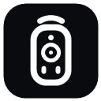

<p align="center">
  
</p>

<h1 align="center">Pult <span title="pult = remote control, in Russian and German">🎛️</span></h1>

<p align="center">
  <b>Fast, light, and private. Phone as a remote and dock for your Windows PC.</b>
</p>

<p align="center">
  Control apps, volume, media playback, mouse, and power over local Wi-Fi in milliseconds.<br/>
  Zero cloud. Zero accounts. Zero telemetry. Nothing leaves your local machine.
</p>

<p align="center">
  <a href="https://github.com/sailxx/pult/releases/latest"></a>
  <a href="https://github.com/sailxx/pult/releases/latest"></a>
  <a href="LICENSE"></a>
  <a href="https://github.com/sailxx/pult/actions/workflows/ci.yml"></a>
</p>

<p align="center">
  <a href="#install">Install</a> •
  <a href="#what-pult-does-that-the-others-dont">Why Pult</a> •
  <a href="#features">Features</a> •
  <a href="#how-it-works">How It Works</a> •
  <a href="docs/PROTOCOL.md">Protocol</a> •
  <a href="SECURITY.md">Security</a> •
  <a href="#contributing">Contribute</a>
</p>

<p align="center">
  
</p>

---

## Control your PC from where you sit

You are watching a movie across the room, listening to music while cooking, or working with your phone docked beside your keyboard.

- Skip the track or adjust the volume without reaching for your mouse.
- Launch your favorite apps, games, or terminal in one tap.
- Lock your workstation or put the monitors to sleep when you walk away.
- Use your phone screen as a responsive wireless trackpad.

Pult connects your Android smartphone directly to your Windows PC over Wi-Fi without cloud relays, logins, or tracking.

---

## What Pult does that the others don't

Remote control tools are often bloated, demand accounts, route packets through cloud servers, or require heavy runtime environments. Pult takes the opposite approach.

| Capability | Pult | Unified Remote | KDE Connect | TeamViewer / AnyDesk |
|---|:---:|:---:|:---:|:---:|
| **Zero accounts or sign-in** | ✅ | ⚠️ (Account pushes) | ✅ | ❌ (Mandatory account) |
| **Zero cloud / strictly local network** | ✅ | ⚠️ | ✅ | ❌ (Cloud relay) |
| **Host size & dependencies** | **32 KB** (Zero deps) | ~40 MB | ~100 MB | ~50 MB |
| **No .NET SDK / Visual C++ needed** | ✅ (Built-in `csc`) | ❌ | ❌ | ❌ |
| **Two-way hardware volume sync (0-100%)** | ✅ (Core Audio) | ⚠️ (Keys only) | ⚠️ | ❌ |
| **Instant app launch & Start menu sync** | ✅ | ⚠️ (Paid add-on) | ❌ | ❌ |
| **Touchpad & 60 fps gesture control** | ✅ | ✅ | ✅ | ⚠️ (Screen streaming lag) |
| **Window & task switcher (Bring to front / Kill)** | ✅ | ❌ | ❌ | ⚠️ |
| **Open source & MIT-licensed** | ✅ | ❌ (Proprietary) | ✅ (GPL) | ❌ (Proprietary) |

---

## Features

### ⚡ Fast & Instant
- **Single-click launch**: Scans your Windows Start Menu and Desktop shortcuts, extracts high-res 96×96 icons, and launches apps via native shell execute.
- **Real-time search**: Filter through hundreds of installed applications as you type.
- **Favorites**: Long-press any app card to pin it to the top of your dock with a gold accent border.

### 🔊 Two-Way Hardware Audio
- **True volume slider**: Integrates directly with Windows Core Audio API (`IAudioEndpointVolume`). Unlike apps that simply send blind Volume Up/Down keystrokes, Pult reads the exact system audio level (0–100%) and updates in real-time.
- **Instant mute toggle**: Hardware mute state sync with visual indicators.

### 🖱️ Responsive Trackpad
- **Ultra-low latency**: Touchpad stream tuned for 60 fps local Wi-Fi operation.
- **Intuitive gestures**:
  - Single tap: Left click
  - Double tap: Double click
  - Long press: Right click (context menu)
  - Scroll buttons: Fast page up/down scroll
- Dedicated ergonomic L/R mouse buttons for comfortable one-handed use.

### 🔒 System & Power Management
- **Security**: Lock your workstation (`Win + L`) in a single tap.
- **Energy**: Turn off connected monitors or send the PC to Sleep mode.
- **Workflow**: Show Desktop (`Win + D`), Alt+Tab window switcher.
- **Safe Power**: Timed Shutdown and Restart with a safety confirmation dialog and a one-click abort button (`shutdown /a`).

### 🪟 Live Task Switcher
- View all active top-level windows currently open on your PC.
- Switch focus to any application immediately or close unresponsive windows.

---

## Install

### 1. Windows Host
1. Download [`Pult.exe`](https://github.com/sailxx/pult/releases/latest) (single 32 KB standalone binary).
2. Run `Pult.exe`. It will appear in your system notification tray.
3. Right-click the tray icon > click **«Разрешить в брандмауэре»** (one-time firewall rule creation for ports 47800 and 47801).
4. Click the tray icon to view your PC's local IP address and 6-digit PIN.

### 2. Android Client
1. Download and install [`Pult.apk`](https://github.com/sailxx/pult/releases/latest).
2. Tap **«Поиск ПК»** for automatic discovery, or enter your PC's IP and 6-digit PIN.
3. Tap **«Подключить»** — you are now in full control!

---

## How It Works

```
┌────────────────────────┐                   ┌────────────────────────┐
│   Android Smartphone   │                   │       Windows PC       │
│  (Kotlin + Compose M3) │                   │ (C# Native Host in Tray)│
│                        │                   │                        │
│  UDP Broadcast: PULT?  │ ───────────────>  │  Listens on UDP 47801  │
│                        │ <───────────────  │  Answers: PULT!47800|PC│
│                        │                   │                        │
│  HTTP GET /volume      │ ───────────────>  │  Core Audio API        │
│  HTTP POST /launch     │ ───────────────>  │  Process.Start()       │
│  HTTP POST /mouse      │ ───────────────>  │  mouse_event()         │
└────────────────────────┘  Local Wi-Fi Network └────────────────────────┘
```

- **Discovery (UDP 47801)**: Broadcasts `PULT?` to discover all Pult instances in your subnet. If your Wi-Fi router isolates UDP broadcast between clients, Pult automatically performs an asynchronous subnet sweep via `GET /ping`.
- **Control API (TCP 47800)**: Compact, zero-dependency HTTP server built directly on .NET `TcpListener`. State changes require an `X-Pin` header matching the host's dynamic PIN.

Full API schema and curl examples are documented in [docs/PROTOCOL.md](docs/PROTOCOL.md).

---

## Security

- **Strictly local**: No packets ever leave your home/office network.
- **Crypto PIN**: 6-digit PIN generated via `RandomNumberGenerator`.
- **Brute-force lockout**: 10 consecutive failed PIN attempts trigger an automatic 60-second connection lockout.
- **VPN bypass**: Android client explicitly binds network traffic to physical Wi-Fi, preventing accidental routing through third-party VPNs.

Full threat model details: [SECURITY.md](SECURITY.md).

---

## Building from Source

### Windows Host
The Windows server requires **zero SDK installations**. It compiles using the C# compiler built into every copy of Windows:
```cmd
host\build.cmd
```

### Android Client
Requires JDK 17+ and the Android SDK:
```bash
cd android
./gradlew assembleRelease
```

---

## Roadmap

- [x] Initial Windows Host and Android Client
- [x] Modern Asterisk/Remote branding and iconography
- [x] Two-way hardware volume control via Core Audio API
- [x] Multi-gesture trackpad and mouse control
- [x] Windows task switcher and active window management
- [ ] Now Playing widget with album art & track metadata (GSMTC API)
- [ ] Quick Actions / Custom user scripts (PowerShell, batch files)
- [ ] iOS client (SwiftUI)

---

## Contributing

Pult is open source under the [MIT License](LICENSE). Contributions of any kind are welcome!
- Check [docs/CONTRIBUTING.md](docs/CONTRIBUTING.md) for setup and guidelines.
- Report bugs and request features through [GitHub Issues](https://github.com/sailxx/pult/issues).

---

## License

MIT © 2026 [@sailxx](https://github.com/sailxx)
