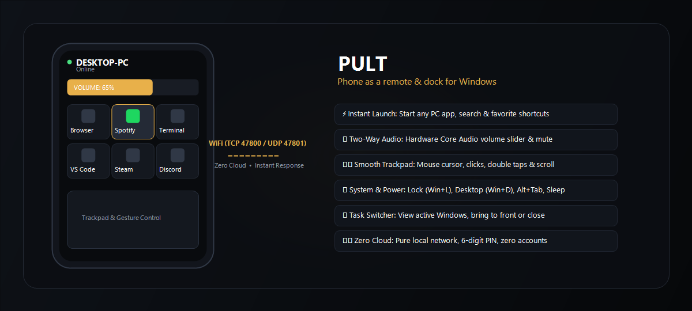
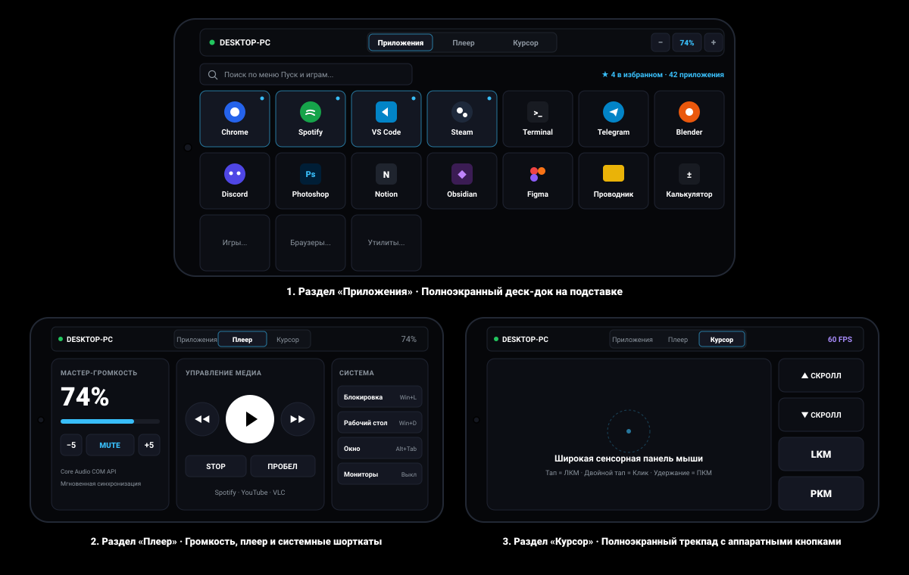

<div align="center">

<picture>
  <source media="(prefers-color-scheme: dark)" srcset="assets/banner-dark.svg">
  
</picture>

<p>
  <b>Phone as a landscape desk dock and second screen for your Windows PC.</b><br/>
  Fullscreen apps grid, hardware volume &amp; media player, and wireless trackpad over local Wi-Fi.
</p>

<p>
  <a href="https://github.com/sailxx/Pult/releases/latest/download/Pult.exe"></a>
  &nbsp;
  <a href="https://github.com/sailxx/Pult/releases/latest/download/Pult.apk"></a>
</p>

<p>
  <a href="https://github.com/sailxx/Pult/releases/latest"></a>
  <a href="https://github.com/sailxx/Pult/releases/latest"></a>
  <a href="LICENSE"></a>
  <a href="https://github.com/sailxx/Pult/actions/workflows/ci.yml"></a>
</p>

[⚡ Quick Start](#-quick-start) • [💡 Why Pult](#-why-pult) • [📸 Interface](#-interface-screenshots) • [🎛️ 3 Sections](#️-the-3-dock-sections) • [🗺️ Roadmap](#️-roadmap) • [📊 Comparison](#-comparison) • [🌐 Protocol](docs/PROTOCOL.md) • [🛠️ Build](#️-building-from-source)

</div>

<br/>



<br/><br/>

## 💡 Why Pult

Pult is not a TV remote with cluttered buttons. It turns your phone on a desk stand into a **minimalist, fullscreen landscape dock** for your Windows PC:

* **Phone on a desk stand:** Place your phone horizontally beside your keyboard. Instantly launch Chrome, Spotify, VS Code, Steam, or Terminal with a single tap on crisp 96×96 cached icons.
* **Bedside media control:** One swipe to the Media deck to adjust master hardware volume with the Core Audio slider, toggle mute, or pause videos without touching your keyboard.
* **Wireless mouse anywhere:** One swipe to the Cursor deck turns the entire widescreen display into a smooth 60 fps precision trackpad with tap-to-click, two-finger scrolling, and thumb buttons.
* **100% offline & local:** Pult communicates strictly peer-to-peer over your local Wi-Fi router or mobile hotspot. Zero cloud servers, zero telemetry, zero accounts.

<br/>



<br/><br/>



<br/><br/>

## 📸 Interface Screenshots

The application runs in **fullscreen landscape mode** on AMOLED black (`#000000`), divided into 3 dedicated, focused sections:

<br/>



<br/>

* **1. Приложения (Fullscreen Apps Grid):** A 7-column wide application launchpad and switcher. Displays all installed Windows Start Menu and Desktop shortcuts with cached icons, instant fuzzy search, and long-press favorite pinning.
* **2. Плеер (Hardware Audio & Media Player):** Direct Windows Core Audio COM master volume slider (0–100%) with ±5 stepper buttons, quick MUTE toggle, large tactile Play/Pause, Next/Prev, Space, and instant PC shortcuts (`Win+L`, `Win+D`, `Alt+Tab`, Monitors Standby).
* **3. Курсор (Wireless Touchpad):** An expansive 60 fps touch surface for fluid mouse cursor control, double-tap click, right-click, smooth vertical scroll strip, and ergonomic hardware `LKM` / `PKM` buttons.

<br/>

## 🎛️ The 3 Dock Sections

### 📱 1. Fullscreen Apps Deck
* Automatically indexes applications and games from the Windows Start Menu and Desktop shortcuts.
* High-density 7-column widescreen grid optimized for desk stands.
* Extracts 96×96 crisp PNG icons directly from executables with in-memory caching.
* Instant fuzzy search as you type.
* Long-press any app to pin it to your favorites dock with priority positioning.

### 🎵 2. Media Player Deck
* Master volume integration via native Windows Core Audio COM API (`IAudioEndpointVolume`).
* Live two-way volume slider: adjust volume on your PC with physical keyboard keys, and the phone updates instantaneously.
* Large, tactile Play / Pause, Next, Prev, Stop, and Space controls.
* Quick desktop system actions: Lock (`Win + L`), Desktop (`Win + D`), App cycle (`Alt + Tab`), and display standby.

### 🖱️ 3. Finger Cursor Control
* 60 fps ultra-low-latency mouse control over local TCP sockets.
* Native gesture support:
  * **Single tap:** Left click
  * **Double tap:** Double click
  * **Long press:** Right click
  * **Dedicated scroll strip:** Smooth vertical document and web browsing
* Physical landscape thumb buttons for left and right click.

<br/>

## 🗺️ Roadmap



<br/>

| Milestone | Status | Key Deliverables |
|---|:---:|---|
| **v0.2 — Landscape Dock & Zero-Lag Core** | **Shipped** | Fullscreen landscape dock, Core Audio COM volume, 60 fps Trackpad, Start Menu apps index, pure offline UDP discovery, 40 KB native host. |
| **v0.3 — Media Art & Quick Macros** | **In Progress** | GSMTC Windows media integration (live track title, artist, live album artwork thumbnail on phone), custom one-tap PowerShell/CMD quick action macros. |
| **v0.4 — Companion & Telemetry** | **Planned** | iOS Companion Client (SwiftUI), Android Lock screen media controls widget, real-time PC telemetry dock (CPU temperature, GPU load, RAM usage). |
| **v1.0 — Production Suite** | **Future** | Encrypted local TLS/WSS transport with auto-generated self-signed LAN certificates, multi-monitor display switching, bidirectional clipboard bridge. |

<br/>

## 📊 Comparison

| Dimension | Pult | Unified Remote | KDE Connect | TeamViewer / AnyDesk |
|---|:---:|:---:|:---:|:---:|
| **Form factor** | Landscape Desk Dock | Vertical remote | Vertical remote | Remote desktop stream |
| **Accounts or sign-up** | None | Optional | None | Mandatory |
| **Network path** | 100% offline LAN | Local + Telemetry | Local | Cloud relay |
| **PC Host binary** | **40 KB** | ~45 MB | ~110 MB | ~55 MB |
| **Host dependencies** | None (Native Win32/C#) | .NET Runtimes | KDE runtime pack | Proprietary drivers |
| **Volume control** | Core Audio COM (0-100%) | Blind key simulation | Blind key simulation | None |
| **Start menu launchpad** | Automatic with cached icons | Paid addon | None | None |
| **Wireless trackpad** | 60 fps relative delta | 60 fps | 60 fps | High video stream lag |
| **License** | Open source (MIT) | Proprietary | Open source (GPL) | Proprietary |

<br/>

## ⚡ Quick Start

### 1. Windows Host
1. Download [`Pult.exe`](https://github.com/sailxx/Pult/releases/latest/download/Pult.exe) (single 40 KB executable, zero installer).
2. Run `Pult.exe`. The remote icon will appear in your system notification tray.
3. Right-click the tray icon and select **«Разрешить в брандмауэре»** for automatic Windows Firewall setup.
4. Left-click the tray icon to see your PC's local IP and current 6-digit security PIN.

### 2. Android Client
1. Download and install [`Pult.apk`](https://github.com/sailxx/Pult/releases/latest/download/Pult.apk).
2. Place phone on your desk stand in landscape orientation.
3. Tap **«Поиск»** for automatic UDP discovery, enter your PIN, and tap **«Подключить»**.

<br/>

## 🌐 Network Architecture

```
┌──────────────────────────────────────────────┐                 ┌─────────────────────────────────┐
│           Android Phone (Landscape)         │                 │           Windows PC            │
│          (Kotlin + Jetpack Compose)          │                 │        (Native C# Host)         │
│                                              │                 │                                 │
│  UDP Broadcast: PULT?                        │ ──────────────> │  UDP 47801 Discovery Listener   │
│                                              │ <────────────── │  Answers: PULT!47800|DESKTOP-PC │
│                                              │                 │                                 │
│  1. Apps Dock:     POST /launch?id=...       │ ──────────────> │  Process.Start()                │
│  2. Media Player:  GET/POST /volume, /key    │ ──────────────> │  Core Audio COM API, keybd_event│
│  3. Cursor Deck:   POST /mouse?dx=..&dy=..   │ ──────────────> │  mouse_event() Win32            │
└──────────────────────────────────────────────┘  Local Network  └─────────────────────────────────┘
```

* **Discovery (UDP 47801):** Broadcast beacon with automatic subnet sweep fallback if router client isolation is active.
* **REST API (TCP 47800):** Lightweight HTTP server with cryptographically secure PIN authentication (`RandomNumberGenerator`) and brute-force lockout (10 failed tries = 60-second lock).

Full API endpoints and curl examples are documented in [docs/PROTOCOL.md](docs/PROTOCOL.md).

<br/>

## 🛠️ Building from Source

### Windows Host (Zero SDKs required)
Compiles directly with the native C# compiler present on every modern Windows installation:
```cmd
host\build.cmd
```

### Android Client
Built with Kotlin and Jetpack Compose:
```bash
cd android
./gradlew assembleRelease
```

<br/>

## 📄 License

MIT © 2026 [@sailxx](https://github.com/sailxx)
