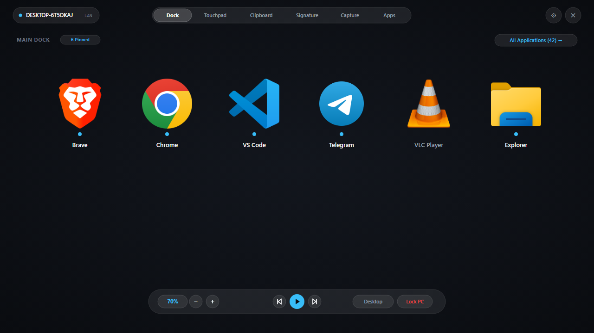
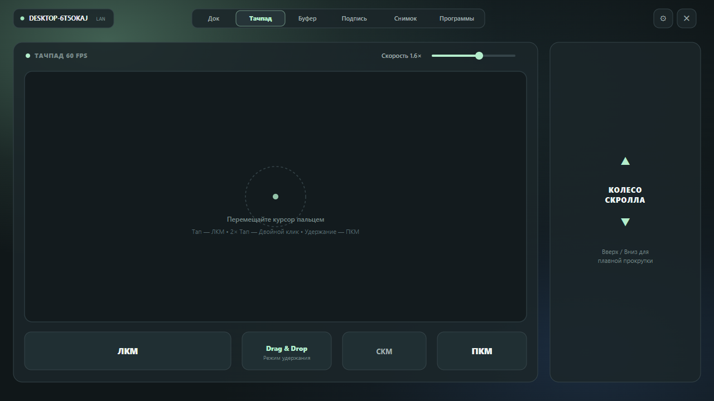
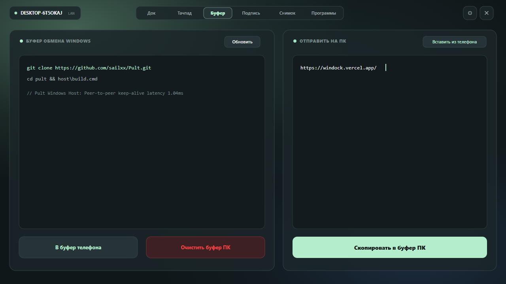
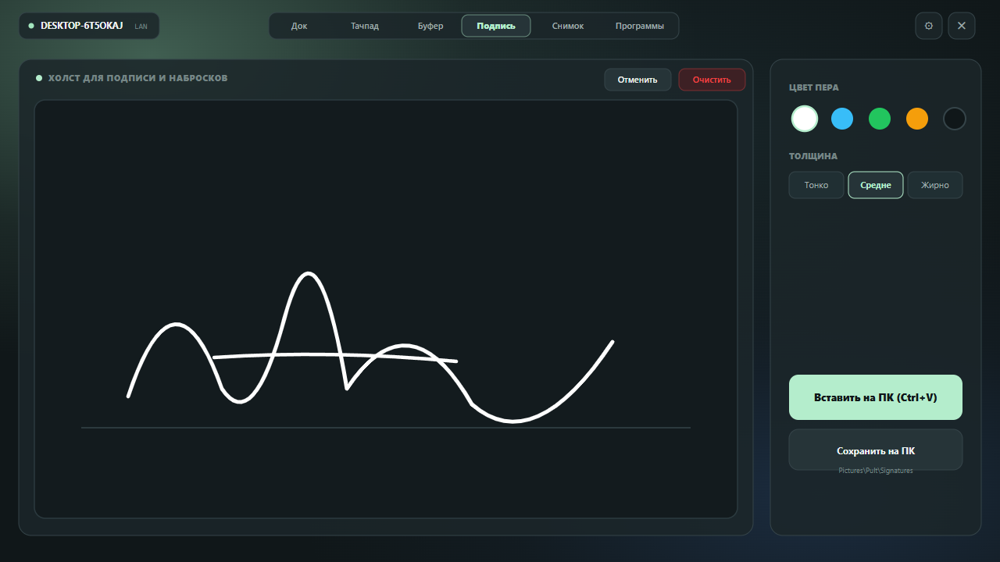
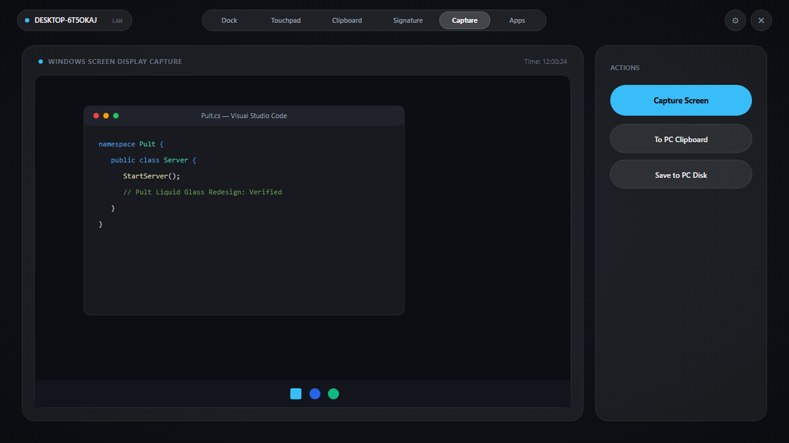

<div align="center">

<picture>
  <source media="(prefers-color-scheme: dark)" srcset="assets/banner-dark.svg">
  
</picture>

<p>
  <b>Turn your phone into a landscape desk companion and control dock for Windows PC.</b><br/>
  Apple-grade Liquid Glass launchpad, bidirectional clipboard bridge, 60&nbsp;fps glass trackpad, stylus signature canvas, and live desktop capture over local Wi-Fi.
</p>

<p>
  <a href="https://github.com/sailxx/Pult/releases/latest/download/Pult.exe"></a>
  &nbsp;
  <a href="https://github.com/sailxx/Pult/releases/latest/download/Pult.apk"></a>
</p>

<p>
  <a href="https://github.com/sailxx/Pult/releases/latest"></a>
  <a href="https://github.com/sailxx/Pult/releases/latest"></a>
  <a href="LICENSE"></a>
  <a href="https://github.com/sailxx/Pult/actions/workflows/ci.yml"></a>
  
</p>

[⚡ Quick Start](#-quick-start) • [✨ Key Features](#-key-features) • [🖼️ Interface Showcase](#️-interface-showcase) • [🎨 Liquid Glass & Themes](#-liquid-glass--themes) • [🪟 Windows Companion](#-windows-11-modern-flyout-companion) • [🌐 Protocol](docs/PROTOCOL.md) • [🛠️ Build](#️-building-from-source)

</div>

<br/>

<div align="center">
  
</div>

<br/><br/>

## 💡 Why Pult

Most remote control apps look like outdated TV remotes or clumsy media players. **Pult** reimagines your smartphone as an elegant, horizontal desk companion resting beside your computer:

* **Horizontal Desk Companion:** Dock your phone in landscape on a wireless charging stand. Launch frequent tools (VS Code, Brave, Chrome, Telegram, Terminal) with one tap on crisp, authentic high-resolution extracted icons.
* **Apple-Grade Liquid Glass Aesthetics:** Clean dark matte background (`#0C0E12`), floating frosted glass capsules, zero square card borders, and glowing active process indicators.
* **Instant Media & Hardware Audio:** Master Windows Core Audio control (`0–100%`) with ±5 steppers, mute badge, and tactile media keys directly on the floating Now Playing pill.
* **Two-Way Clipboard Synchronization:** Effortlessly push snippets, code blocks, or URLs from your phone into the Windows clipboard, or inspect and grab whatever is currently copied on your PC.
* **Zero Cloud & Zero Accounts:** Pult is 100% peer-to-peer over local LAN/Wi-Fi. No accounts, no telemetry, no relays, no external servers.
* **Ultra-Low Latency:** Persistent HTTP Keep-Alive connection pooling with `TCP_NODELAY` delivers **~1.04 ms/req** response times.

<br/>

---

## ✨ Key Features

| Tool | Capability | Windows Host Integration |
|---|---|---|
| **🚀 Hero Dock & Apps** | Pure floating official EXE icons, active process indicators, favorite pinning, and full app library search | `Process.Start()`, Shell indexing, Win32 window switching |
| **📋 Bidirectional Clipboard** | Live PC clipboard inspection, one-tap copy to phone, push text to PC, clear remote PC buffer | Win32 STA Clipboard API (`GetText` / `SetText`) |
| **🖱️ Precision Glass Touchpad** | Smooth 60 fps mouse navigation, tap-to-click, double tap, hold Drag & Drop mode, scroll strip | Conflated atomic delta dispatcher & `mouse_event` |
| **✍️ Stylus & Finger Signature** | Quadratic Bézier curve inking, 5-color palette, stroke width, undo, direct clipboard injection | Injected as native `Bitmap` object for instant `Ctrl+V` |
| **📸 Desktop Screen Capture** | Real-time screenshot fetch with landscape preview, save to `Pictures\Pult`, or copy to clipboard | Direct GDI+ desktop capture (`CopyFromScreen`) |
| **🪟 Windows 11 Companion** | Modern Flyouts Mica window in system tray; Volume mixer, app volume, monitor brightness, PIN and IP sharing | DWM Mica Win32 API (`DWMWA_SYSTEMBACKDROP_TYPE`) |

<br/>

---

## 🖼️ Interface Showcase

### 1. 🚀 Hero Dock & Apps Library
Крупные свободно парящие значки приложений без квадратных рамок и обводок, аккуратная светящаяся точка запущенных процессов, верхний бар навигации и компактная парящая нижняя капсула Now Playing в стиле Liquid Glass.

<div align="center">
  
</div>

<br/>

### 2. 🖱️ 60 FPS Precision Glass Touchpad
Сенсорная панель управления мышью с кинетическим скольжением, слайдером чувствительности от 0.5× до 3.0× и стеклянными кнопками ЛКМ и ПКМ.

<div align="center">
  
</div>

<br/>

### 3. 📋 Bidirectional Clipboard Bridge
Мгновенная двухсторонняя синхронизация буфера обмена между смартфоном и компьютером без облака и задержек.

<div align="center">
  
</div>

<br/>

### 4. ✍️ Digital Signature & Inking
Сглаживание линий кривыми Безье, инструменты выбора цвета и толщины, мгновенная вставка подписи прямо в активный документ на ПК (`Ctrl+V`).

<div align="center">
  
</div>

<br/>

### 5. 📸 Desktop Screen Capture
Трансляция рабочего стола Windows в реальном времени с полноразмерным превью и быстрым сохранением в буфер или на диск.

<div align="center">
  
</div>

<br/>

---

## 🎨 Liquid Glass & Themes

По умолчанию в Pult активирована чистая темная матовая тема **Dark Minimal** (`#0C0E12`) без навязчивых цветных пятен. В настройках доступны опциональные богатые радиальные градиентные палитры:

* **⬛ Dark Minimal (По умолчанию):** Глубокий матовый фон (`#0C0E12`), полупрозрачные парящие стеклянные панели Liquid Glass (`Color.White.copy(0.08f)`), тонкие деликатные границы и акцентный небесный цвет (`#38BDF8`).
* **🌿 Aurora:** Изумрудная база (`#101719`) с мягким морским свечением (`#71A78A`), глубоким индиго (`#274268`) и мятными акцентами (`#B4EDCC`).
* **🌆 Dusk:** Сумеречный индиго (`#171228`) с аметистовыми переливами (`#8B578F`) и лавандовыми акцентами (`#E7D4FF`).
* **🔥 Ember:** Терракотовый графит (`#221615`) с медными полутонами (`#A45F43`) и персиковыми деталями (`#F8DCC0`).
* **🌌 Midnight:** Глубокий ультрамарин (`#090E17`) с кобальтовыми и ледяными акцентами (`#D0E2FF`).
* **🖤 OLED Pure:** Абсолютно черный холст (`#000000`) для экономии батареи на AMOLED-экранах.

<br/>

---

## 🪟 Windows 11 Modern Flyout Companion

Компаньон Pult для Windows располагается в системном трее и выполнен в нативном стиле Windows 11 Modern Flyouts:

<div align="center">
  
</div>

<br/>

* **Слайдеры громкости и яркости:** Управление звуком мастер-устройства `Speakers (Realtek(R) Audio)` с активным вертикальным маркером, ползунок активных программ (Brave Browser), яркость дисплея, фильтр синего света и затемнение.
* **Быстрый доступ к сопряжению:** Отображение статуса LAN, одно нажатие для копирования PIN-кода и IP-адреса компьютера.
* **Интеграция с брандмауэром:** Автоматическая настройка входящих правил Windows Defender Firewall в один клик.
* **Автономный бинарник:** Standalone исполняемый файл размером ~60 КБ без зависимостей от тяжелых фреймворков.

<br/>

---

## ⚡ Quick Start

### 1. Windows Host Setup
1. Скачайте [`Pult.exe`](https://github.com/sailxx/Pult/releases/latest/download/Pult.exe) (одиночный файл ~60 КБ, установка не требуется).
2. Запустите `Pult.exe`. Иконка появится в системном трее Windows.
3. Кликните по иконке в трее, чтобы открыть flyout-окно и узнать 6-значный PIN.
4. При первом запуске в меню настроек ⚙️ нажмите **«Разрешить в брандмауэре Windows»**.

### 2. Android Client Setup
1. Скачайте и установите [`Pult.apk`](https://github.com/sailxx/Pult/releases/latest/download/Pult.apk).
2. Установите смартфон горизонтально на настольную подставку.
3. Нажмите **«Поиск»** для автоматического обнаружения ПК в локальной сети.
4. Введите 6-значный PIN-код и нажмите **«Подключить»**.

<br/>

---

## 🌐 Architecture & Protocol

```
┌──────────────────────────────────────────────┐                 ┌─────────────────────────────────┐
│           Android Phone (Landscape)         │                 │           Windows PC            │
│          (Kotlin + Jetpack Compose)          │                 │        (Native C# Host)         │
│                                              │                 │                                 │
│  UDP Broadcast: PULT?                        │ ──────────────> │  UDP 47801 Discovery Beacon     │
│                                              │ <────────────── │  Answers: PULT!47800|DESKTOP-PC │
│                                              │                 │                                 │
│  1. Hero Dock:     POST /launch?id=...       │ ──────────────> │  Process.Start()                │
│  2. Audio Strip:   GET/POST /volume, /key    │ ──────────────> │  Core Audio COM API             │
│  3. Clipboard:     GET/POST /clipboard       │ ──────────────> │  Win32 STA Clipboard Thread     │
│  4. Touchpad:      POST /mouse?dx=..&dy=..   │ ──────────────> │  mouse_event() Win32            │
│  5. Signature:     POST /signature?action=.. │ ──────────────> │  System.Drawing Bitmap buffer   │
│  6. Capture:       GET/POST /capture         │ ──────────────> │  GDI+ CopyFromScreen            │
└──────────────────────────────────────────────┘  Local Network  └─────────────────────────────────┘
```

* **Discovery (UDP 47801):** Мгновенное P2P обнаружение через широковещательный маяк со сканированием подсети.
* **Control API (TCP 47800):** Keep-Alive HTTP сервер с криптографическим PIN и защитой от перебора (10 неудачных попыток = блокировка на 60 сек).
* **Спецификация протокола:** Полный список эндпоинтов и форматов запросов доступен в [docs/PROTOCOL.md](docs/PROTOCOL.md).

<br/>

---

## 🛠️ Building from Source

### Windows Host (Zero SDKs Required)
Компилируется стандартным компилятором C#, встроенным в любую версию Windows:
```cmd
host\build.cmd
```

### Android Client
Собирается с помощью Gradle и Android SDK:
```bash
cd android
./gradlew assembleRelease
```

<br/>

---

## 📄 License & Credits

Pult распространяется под лицензией **MIT License**. См. [LICENSE](LICENSE) для подробностей.

Разработано [@sailxx](https://github.com/sailxx). Вопросы, баг-репорты и предложения приветствуются в [GitHub Issues](https://github.com/sailxx/Pult/issues)!
