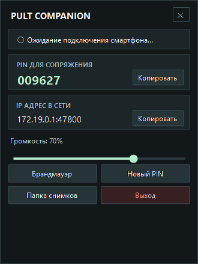

<div align="center">

<picture>
  <source media="(prefers-color-scheme: dark)" srcset="assets/banner-dark.svg">
  
</picture>

<p>
  <b>Turn your phone into a landscape desk companion and control dock for Windows PC.</b><br/>
  App launchpad, bidirectional clipboard bridge, 60&nbsp;fps glass trackpad, stylus signature canvas, and live desktop capture over local Wi-Fi.
</p>

<p>
  <a href="https://github.com/sailxx/Pult/releases/latest/download/Pult.exe"></a>
  &nbsp;
  <a href="https://github.com/sailxx/Pult/releases/latest/download/Pult.apk"></a>
</p>

<p>
  <a href="https://github.com/sailxx/Pult/releases/latest"></a>
  <a href="https://github.com/sailxx/Pult/releases/latest"></a>
  <a href="LICENSE"></a>
  <a href="https://github.com/sailxx/Pult/actions/workflows/ci.yml"></a>
  
</p>

[⚡ Quick Start](#-quick-start) • [✨ Key Features](#-key-features) • [🖼️ Interface Showcase](#️-interface-showcase) • [🎨 Palettes](#-5-curated-themes) • [🪟 Windows Companion](#-windows-11-mica-companion) • [🌐 Protocol](docs/PROTOCOL.md) • [🛠️ Build](#️-building-from-source)

</div>

<br/>

<div align="center">
  
</div>

<br/><br/>

## 💡 Why Pult

Most remote control apps look like outdated TV remotes or clumsy media players. **Pult** reimagines your smartphone as an elegant, horizontal desk companion resting beside your computer:

* **Horizontal Desk Companion:** Dock your phone in landscape on a wireless charging stand. Launch frequent tools (VS Code, Chrome, Terminal, Steam) with one tap on crisp, real extracted `.exe` icons.
* **Instant Media & Hardware Audio:** Master Windows Core Audio control (`0–100%`) with ±5 steppers, mute badge, and tactile media keys directly on the main dock strip.
* **Two-Way Clipboard Synchronization:** Effortlessly push snippets, code blocks, or URLs from your phone into the Windows clipboard, or inspect and grab whatever is currently copied on your PC.
* **Zero Cloud & Zero Accounts:** Pult is 100% peer-to-peer over local LAN/Wi-Fi. No accounts, no telemetry, no relays, no external servers.
* **Ultra-Low Latency:** Persistent HTTP Keep-Alive connection pooling with `TCP_NODELAY` delivers **~1.04 ms/req** response times.

<br/>

---

## ✨ Key Features

| Tool | Capability | Windows Host Integration |
|---|---|---|
| **🚀 Hero Dock & Apps** | 4, 6, or 8 configurable glass tiles with real EXE icons, process indicators, favorite pinning, and full app search | `Process.Start()`, Shell indexing, Win32 window switching |
| **📋 Bidirectional Clipboard** | Live PC clipboard inspection, one-tap copy to phone, push text to PC, clear PC clipboard | Win32 STA Clipboard API (`GetText` / `SetText`) |
| **🖱️ Precision Glass Touchpad** | Smooth 60 fps mouse navigation, tap-to-click, double tap, hold Drag & Drop mode, scroll strip | Conflated atomic delta dispatcher & `mouse_event` |
| **✍️ Stylus & Finger Signature** | Quadratic Bézier curve inking, 5-color palette, stroke width, undo, direct clipboard injection | Injected as native `Bitmap` object for instant `Ctrl+V` |
| **📸 Desktop Screen Capture** | Real-time screenshot fetch with landscape preview, save to `Pictures\Pult`, or copy to clipboard | Direct GDI+ desktop capture (`CopyFromScreen`) |
| **🪟 Windows 11 Companion** | Native Mica backdrop flyout from system notification tray; PIN generation, IP sharing, firewall setup | DWM Mica Win32 API (`DWMWA_SYSTEMBACKDROP_TYPE`) |

<br/>

---

## 🖼️ Interface Showcase

<div align="center">
  
</div>

<br/>

### 1. 🚀 Hero Dock & Apps Library
* **Custom Slot Sizing:** Seamlessly toggle between **4**, **6**, or **8** prominent glass tiles.
* **Original EXE Icons:** Automatically extracted from Windows shortcuts and cached on-device with high-DPI clarity.
* **Process Status Dots:** Glowing indicators highlight currently active Windows processes.
* **Full Apps Library:** Search through every installed desktop software and game with instant fuzzy filtering.

### 2. 📋 Bidirectional Clipboard Bridge
* **Read PC Clipboard:** Inspect the active clipboard contents of your computer in real time.
* **Copy to Mobile:** Copy PC snippets directly into Android's native `ClipboardManager`.
* **Push to PC:** Type or paste on your smartphone and inject directly into the Windows clipboard with a single tap.
* **Clear Remote Clipboard:** Securely wipe the PC clipboard buffer whenever necessary.

### 3. 🖱️ 60 FPS Precision Glass Touchpad
* **Conflated Motion Dispatcher:** Atomic delta accumulation prevents packet backlog and cursor drift.
* **Sensitivity Slider:** Real-time speed adjustment from **0.5×** to **3.0×**.
* **Gestures & Buttons:** Single tap for Left Click, double-tap, long-press for Right Click, Middle Click (SCM), and a dedicated **Drag & Drop lock** toggle.
* **Dedicated Scroll Strip:** Smooth vertical scrolling with haptic tactile feedback.

### 4. ✍️ Digital Signature & Inking
* **Stylus & Finger Inking:** Smooth drawing canvas with Bézier path smoothing.
* **Ink Customization:** 5 ink colors (White, Sky Accent, Green, Amber, Dark) with variable stroke widths.
* **Insert to PC:** Copies the signature directly as a bitmap to the PC clipboard for immediate `Ctrl+V` pasting into Word, PDF, Figma, or Photoshop.
* **Save to Disk:** Saves a clean PNG to `Pictures\Pult\Signatures`.

### 5. 📸 Desktop Screen Capture
* **Live Display Preview:** View the active desktop screen right on your mobile display.
* **Copy to PC Clipboard:** One-tap button to capture the screenshot and place it in the PC clipboard.
* **Save to PC Disk:** Automatically timestamped and stored in `Pictures\Pult\`.

<br/>

---

## 🎨 5 Curated Themes

Pult features an Apple × Claude × Okto design triad aesthetic, built upon rich ambient radial glow spheres and pure dark contrast surfaces:

<div align="center">
  
</div>

<br/>

* **🌿 Aurora (Default):** Deep emerald base (`#101719`) with soft sea-mist glows (`#71A78A`), deep navy (`#274268`), and fresh mint accents (`#B4EDCC`).
* **🌆 Dusk:** Twilight indigo (`#171228`) paired with soft amethyst glows (`#8B578F`) and lavender focal points (`#E7D4FF`).
* **🔥 Ember:** Warm terracotta charcoal (`#221615`) with amber copper undertones (`#A45F43`) and peach accents (`#F8DCC0`).
* **🌌 Midnight:** Deep space ultramarine (`#090E17`) with cobalt accents and icy blue highlights (`#D0E2FF`).
* **⬛ OLED Pure:** Pitch-black canvas (`#000000`) with high-contrast surfaces (`#0C0E14`) and electric sky accents (`#38BDF8`).

<br/>

---

## 🪟 Windows 11 Mica Companion

Unlike traditional heavy desktop applications, the Pult Windows companion stays unobtrusively in your system notification tray:

<div align="center">
  
</div>

<br/>

* **Native Windows 11 DWM Mica:** Renders with authentic Mica materials, dark mode, and soft rounded window geometry (`DwmSetWindowAttribute`).
* **One-Click Connection Sharing:** Easily copy your PC's local LAN IP address and current 6-digit security PIN.
* **Firewall Helper:** Automated one-click Windows Defender Firewall inbound rule configuration (`advfirewall`).
* **Single Portable Binary:** Single standalone ~40 KB executable with zero runtime dependencies.

<br/>

---

## ⚡ Quick Start

### 1. Windows Host Setup
1. Download [`Pult.exe`](https://github.com/sailxx/Pult/releases/latest/download/Pult.exe) (single 40 KB executable, no installer needed).
2. Run `Pult.exe`. The remote icon will appear in your system notification tray.
3. Left-click the tray icon to open the **Pult Companion** flyout and check your 6-digit PIN.
4. If connecting for the first time, click **«Брандмауэр»** to permit local network traffic.

### 2. Android Client Setup
1. Download and install [`Pult.apk`](https://github.com/sailxx/Pult/releases/latest/download/Pult.apk).
2. Place your smartphone horizontally on your desk stand.
3. Tap **«Поиск»** to automatically discover your PC via local UDP beacon.
4. Enter the 6-digit PIN displayed on your PC and tap **«Подключить»**.

<br/>

---

## 🌐 Architecture & Protocol

```
┌──────────────────────────────────────────────┐                 ┌─────────────────────────────────┐
│           Android Phone (Landscape)         │                 │           Windows PC            │
│          (Kotlin + Jetpack Compose)          │                 │        (Native C# Host)         │
│                                              │                 │                                 │
│  UDP Broadcast: PULT?                        │ ──────────────> │  UDP 47801 Discovery Beacon     │
│                                              │ <────────────── │  Answers: PULT!47800|DESKTOP-PC │
│                                              │                 │                                 │
│  1. Hero Dock:     POST /launch?id=...       │ ──────────────> │  Process.Start()                │
│  2. Audio Strip:   GET/POST /volume, /key    │ ──────────────> │  Core Audio COM API             │
│  3. Clipboard:     GET/POST /clipboard       │ ──────────────> │  Win32 STA Clipboard Thread     │
│  4. Touchpad:      POST /mouse?dx=..&dy=..   │ ──────────────> │  mouse_event() Win32            │
│  5. Signature:     POST /signature?action=.. │ ──────────────> │  System.Drawing Bitmap buffer   │
│  6. Capture:       GET/POST /capture         │ ──────────────> │  GDI+ CopyFromScreen            │
└──────────────────────────────────────────────┘  Local Network  └─────────────────────────────────┘
```

* **Discovery (UDP 47801):** Fast peer-to-peer broadcast beacon with subnet sweep fallback.
* **Control API (TCP 47800):** Keep-Alive HTTP server with cryptographic PIN security and brute-force lockout (10 failed attempts = 60-second cooldown).
* **Protocol Reference:** Detailed endpoints, parameter specifications, and sample payloads are available in [docs/PROTOCOL.md](docs/PROTOCOL.md).

<br/>

---

## 🛠️ Building from Source

### Windows Host (Zero SDKs Required)
Compiles directly with the Microsoft C# compiler present on every modern Windows installation:
```cmd
host\build.cmd
```

### Android Client
Built with Kotlin and Jetpack Compose:
```bash
cd android
./gradlew assembleDebug
```

<br/>

---

## 📄 License & Credits

Pult is licensed under the **MIT License**. See [LICENSE](LICENSE) for full details.

Developed with care by [@sailxx](https://github.com/sailxx). Contributions, bug reports, and suggestions are welcome on [GitHub Issues](https://github.com/sailxx/Pult/issues)!
